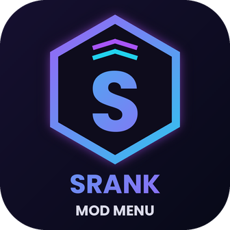

# Srank Mod Menu



A Mega Hack style toolbox for Geometry Dash (Windows, Geode).

## Features

- **Noclip** and **Noclip Accuracy** (percentage of frames spent not touching a hazard, with an optional "die below X%" limit)
- **CPS Counter**
- **Click Indicator** (dot at the bottom of the screen that lights up while you hold click)
- **Speedhack** (with optional music pitch)
- **Auto Pickup Coins**
- **FPS Change**
- **Unlock All Icons** (local only)
- **Safe Mode** (on by default): marks runs as test runs while noclip / speedhack / auto coins are active

The Srank logo shows up in the Geode mod list, as a button in the top-left of the main menu, as a banner on the pause screen, and as a faint watermark in levels. To use your own logo, replace `logo.png` and the files in `resources/` (keep the same names).

Open the settings from the Geode mod list, or press the **Hacks** button in the pause menu.

## Building

### Option A: no local setup (GitHub Actions)

1. Create a new GitHub repository and push this folder to it.
2. Open the **Actions** tab, run **Build Mod**.
3. Download the `.geode` file from the build artifacts.

### Option B: build locally

1. Install the Geode CLI and SDK: https://docs.geode-sdk.org/getting-started/
2. In this folder run:

```
geode build
```

3. Put the resulting `.geode` file in `%LOCALAPPDATA%\GeometryDash\geode\mods\` and restart the game.

## Before you build

- The mod id is `srank.mod-menu`; change `id` and `developer` in `mod.json` if you want something else.
- Set `"geode"` to the version of your installed SDK (`geode sdk version`).
- `"gd": { "win": "2.2081" }` must match your Geometry Dash version.

## Notes

- For FPS above your monitor's refresh rate, turn off VSync in GD's video settings.
- Speedhack scales the whole game's clock, menus included.
- Unlock All Icons is local; it doesn't change your account.
